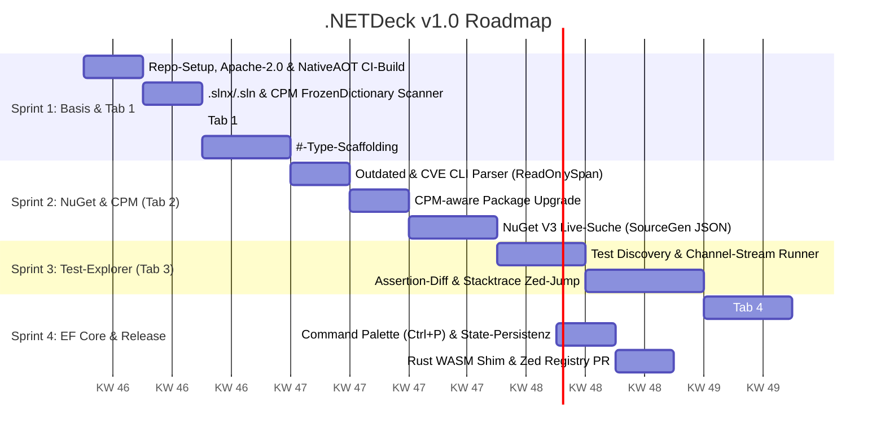

# Projektplan: `.NETDeck` (v1.0 Lean MVP)

**`.NETDeck`** ist eine schlanke, mausbedienbare .NET-10-Kommandozentrale für den Zed-Editor, die die wichtigsten Projekt-, NuGet-, Test- und Datenbank-Workflows aus JetBrains Rider abbildet – ohne die bestehende `csharp`-Extension (Roslyn LSP & Tree-sitter) zu duplizieren.

---

## 1. Projekt-Steckbrief & Leitplanken

| Parameter | Festlegung |
| :--- | :--- |
| **Produktname** | `.NETDeck` |
| **Zed Extension ID** | `dotnet-deck` (`authors = ["konstitech"]`) |
| **CLI-Binary (NativeAOT)** | `dotnet-deck` (auch via `dotnet deck` aufrufbar) |
| **C# Root Namespace** | `konstitech.DotNetDeck` (`Domain`, `Application`, `Infrastructure`, `Tui`) |
| **UI-Paradigma** | **Option A:** Mausbedienbare TUI im integrierten Zed-Terminal (`Terminal.Gui` v2) |
| **Tech-Stack** | .NET 10 (C# 14, NativeAOT) + Rust (`zed_extension_api` -> `wasm32-wasip1`) |
| **Lizenz** | `Apache-2.0` (`Copyright 2026 konstitech`) |
| **Ziel-Latenz (Cold-Start)** | $< 15\text{ ms}$ vom Shortcut (`Alt+R`) bis zur interaktiven Oberfläche |

---

## 2. Funktionsumfang: In-Scope (v1.0 MVP)

Der v1.0-Release konzentriert sich auf **4 fokussierte TUI-Tabs** sowie eine zentrale Command Palette:

1. **Tab 1 – Solution-Explorer & C#-Type-Scaffolding**
   * Interaktiver `TreeView` für `.slnx`- und `.sln`-Workspaces inklusive Target-Frameworks.
   * Klick oder `Enter` auf eine Datei öffnet sie über `zed <file>:<line>` direkt im Editor.
   * Modaldialog **New C# Type** (`class`, `record`, `interface`, `struct`) mit automatischer Ableitung des file-scoped `namespace` aus `<RootNamespace>` und Ordnerpfad.
2. **Tab 2 – NuGet- & CPM-Studio**
   * Anzeige aller Pakete pro Projekt inklusive Outdated- und Sicherheits-Check (`dotnet list package --outdated --vulnerable`).
   * **Central Package Management (CPM):** Erkennt `Directory.Packages.props` (`FrozenDictionary`) und aktualisiert Paketversionen zentral ohne `NU1008`-Konflikte.
   * Inkrementelle Live-Suche gegen die NuGet V3 API (`$300\text{ ms}$` Debounce) mit 1-Klick-Installation.
3. **Tab 3 – Unit-Test-Explorer & Assertion-Diff**
   * Gruppierte Test-Ansicht für `TUnit`, `xUnit` und `NUnit` (`[PASS]`, `[FAIL]`, `[RUN]`).
   * Mausbedienbare Action-Bar: `Run All`, `Run Failed`, `Run Current File` (`$ZED_FILE`).
   * Zweispaltige *Expected vs. Actual*-Ansicht für Assertions und klickbarer Sprung zu Stacktrace-Zeilen in Zed.
4. **Tab 4 – EF Core Migrations-Workbench**
   * Auswahl von `Startup Project` und `Migrations Project` mit persistiertem Workspace-State.
   * Status-Timeline (`Applied` vs. `Pending`), `Add Migration`, `Update Database` (inkl. Ziel-Migration) sowie scrollbare SQL-Vorschau (`--idempotent`).
5. **Querschnitt – Command Palette (`Ctrl+P`) & Zed-Integration**
   * Fuzzy-Schnellsuche über alle TUI-Aktionen.
   * Zed-Task-Anbindung (`Alt+R`, `hide: "always"`), sodass `Esc` die TUI schließt und sofort in den Code-Buffer zurückkehrt.
   * Rust-WASM-Extension (`dotnet-deck`), die das passende Plattform-Binary aus GitHub Releases auflöst und Gutter-Play-Icons (`runnables.scm`) bereitstellt.

---

## 3. Scope-Cut: Bewusst abgeschnittene Features

Um das Projekt in **4 Wochen** sauber auszuliefern und den Wartungsaufwand niedrig zu halten, werden folgende Features aus v1.0 gestrichen:

| Abgeschnittenes Feature | Begründung für den Cut |
| :--- | :--- |
| **Eigener Roslyn LSP & C#-Grammar** | Wird bereits durch `zed.dev/extensions/csharp` abgedeckt; Duplizierung würde doppelten RAM kosten und den Zed-Registry-PR blockieren. |
| **Eigener Debugger / DAP-Client** | Zeds nativer Debugger + `netcoredbg` übernehmen Breakpoints und Variable-Inspection. |
| **`launchSettings.json` Runner & Port-Killer** | Verschoben auf v1.1, um v1.0 auf 4 kompakte Tabs zu begrenzen. |
| **Live Runtime Metrics (`dotnet-counters`)** | Hoher IPC-Aufwand bei geringem Mehrwert gegenüber einem direkten CLI-Aufruf. |
| **Transitive Dependency Tree Viewer** | Das Parsen großer `project.assets.json`-Graphen erhöht Startzeit und UI-Komplexität unnötig. |
| **Clean-Architecture Layer-Guard** | Verschoben auf v1.1; Tab 1 fokussiert sich in v1.0 auf Navigation und Type-Scaffolding. |
| **Cobertura Code-Coverage-Visualisierung** | Erfordert je Test-Framework unterschiedliche Collector-Setups; v1.0 priorisiert schnelle Testläufe und Fehler-Diffs. |

---

## 4. Ziel-Projektstruktur

```text
dotnet-deck/
├── LICENSE                                  # Apache License 2.0 (unveränderter Standardtext)
├── extension.toml                           # Zed Extension Manifest (id = "dotnet-deck")
├── Cargo.toml                               # Rust WASM Crate (wasm32-wasip1)
├── Directory.Build.props                    # Zentrale .NET-10-Properties & Apache-2.0-Metadaten
├── dotnet-deck.slnx                         # Moderne XML-Solution
├── rust-extension/
│   └── src/
│       └── lib.rs                           # Binary-Resolver (GitHub Releases) & Extension-Hooks
├── languages/
│   └── csharp/
│       └── runnables.scm                    # Klickbare Gutter-Icons für Main() & Unit-Tests
└── src/
    ├── konstitech.DotNetDeck.Domain/          # Records, Entities & OperationOutcome<T>
    ├── konstitech.DotNetDeck.Application/     # CQRS-Interfaces & Use-Cases (ohne Async-Suffix)
    ├── konstitech.DotNetDeck.Infrastructure/  # .slnx/CPM-Scanner, NuGet-Client, ProcessSupervisor
    └── konstitech.DotNetDeck.Tui/             # Terminal.Gui v2 Views & NativeAOT Entry-Point
```

---

## 5. Zeit- & Sprint-Plan (4 Wochen)



### Sprint 1 (Woche 1): Fundament, NativeAOT-Pipeline & Tab 1
* **Aufgaben:**
  * Repository-Scaffolding aufsetzen (`dotnet-deck.slnx`, `LICENSE` mit `Apache-2.0`, `Directory.Build.props`).
  * GitHub-Actions-Workflow für NativeAOT-Builds (`linux-x64`, `osx-arm64`, `win-x64`) einrichten.
  * `XmlWorkspaceScanner` für `.slnx`/`.sln` und `Directory.Packages.props` (`FrozenDictionary`) implementieren.
  * **Tab 1** bauen: Solution-`TreeView` mit `zed <file>:<line>`-Sprung + Modaldialog *New C# Type* (`RootNamespace`-Auflösung).
* **Abnahmekriterium:** NativeAOT-Binary startet in $< 15\text{ ms}$; neue C#-Dateien werden mit korrektem Namespace erzeugt und in Zed geöffnet.

### Sprint 2 (Woche 2): NuGet- & CPM-Studio (Tab 2)
* **Aufgaben:**
  * `dotnet list package --outdated --vulnerable` über `ReadOnlySpan<char>` parsen.
  * CPM-bewusstes Upgrade umsetzen (aktualisiert `<PackageVersion>` in `Directory.Packages.props` bzw. `<PackageReference>` in `.csproj`).
  * NuGet V3 Live-Suche mit `System.Text.Json` Source Generation (`[JsonSerializable]`) und `Install`-Button integrieren.
* **Abnahmekriterium:** Paket-Upgrades funktionieren fehlerfrei in CPM- und Non-CPM-Solutions; AOT-Publish läuft ohne Trimming-Warnungen.

### Sprint 3 (Woche 3): Unit-Test-Explorer & Diff-Viewer (Tab 3)
* **Aufgaben:**
  * Test-Discovery und Ausführung (`TUnit`, `xUnit`, `NUnit`) über einen bounded `Channel<LogFrame>` (`$20\text{ FPS}$` UI-Batching) anbinden.
  * Action-Bar (`Run All`, `Run Failed`, `Run Current File`) umsetzen.
  * Assertion-Diff-Parser (*Expected vs. Actual*) und klickbare Stacktrace-Navigation (`zed <file>:<line>`) bauen.
* **Abnahmekriterium:** UI bleibt auch bei hohem Log-Aufkommen flüssig bedienbar; laufende Testprozesse werden beim Schließen (`Esc`) sauber beendet.

### Sprint 4 (Woche 4): EF Core Workbench (Tab 4), Command Palette & Zed-Release
* **Aufgaben:**
  * **Tab 4** bauen: Projekt-Dropdowns, Migrations-Liste (`Applied` / `Pending`), `Add Migration`, `Update Database` und `Preview SQL` (`--idempotent`).
  * Globale Command Palette (`Ctrl+P`) und Persistenz der Projektauswahl (`~/.local/share/dotnet-deck/state.json`) ergänzen.
  * Rust-WASM-Extension (`dotnet-deck`) mit Binary-Downloader (`zed::download_file`) und `runnables.scm` fertigstellen und PR bei `zed-industries/extensions` einreichen.
* **Abnahmekriterium:** End-to-End-Workflow unter Linux, macOS und Windows verifiziert; CI-Checks für `Apache-2.0` und `extension.toml` grün.

---

## 6. Release-Checkliste (v1.0 Gate)

* [ ] **Prozess-Hygiene:** Alle Kindprozesse (`dotnet test`, `dotnet ef`) werden bei `Esc` / `Dispose` über `Kill(entireProcessTree: true)` beendet.
* [ ] **Terminal-Schutz:** Keine direkten Ausgaben auf `stdout`/`stderr` während `Terminal.Gui` aktiv ist (Logs gehen ausschließlich nach `~/.local/share/dotnet-deck/tui.log`).
* [ ] **Zed Registry Compliance:** `LICENSE` liegt unverändert im Root (`Apache-2.0`), keine Bundled-Binaries im Repo, alle UI-Texte auf Englisch.
